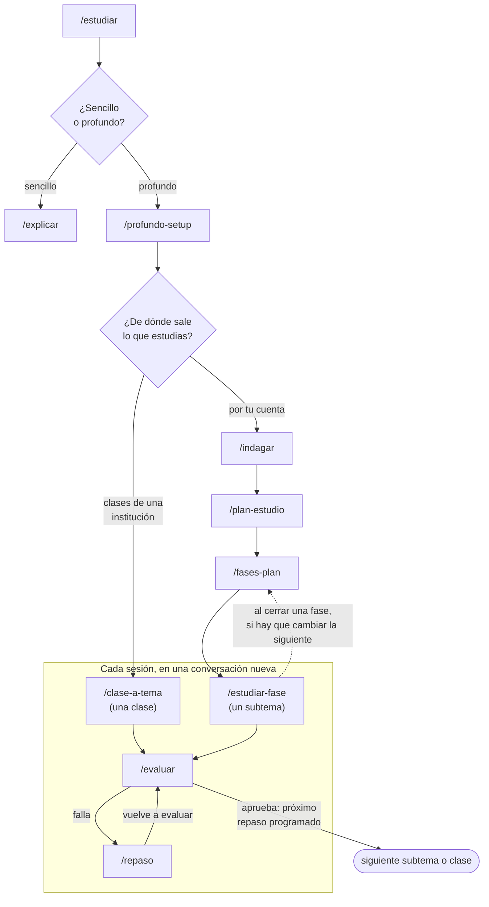

# estudio-skills

Skills para estudiar con un agente de IA. Le dices qué quieres aprender y el agente investiga, arma un plan, escribe páginas de estudio, te evalúa y programa los repasos. Con el tiempo, el sistema aprende cómo aprendes tú y propone cambios para enseñarte mejor.

Sirve para dos tipos de estudio:

- **Por tu cuenta:** el agente busca fuentes fiables y enseña con ellas.
- **Clases de una institución:** la fuente es la clase. El agente convierte la transcripción o tus apuntes en páginas de estudio.

## Instalación

Necesitas un agente que use skills y pueda lanzar subagentes, como [Claude Code](https://claude.com/claude-code), y Node.js.

1. Instala todas las skills:

   ```
   npx skills add ruben-salas20/estudio-skills -g
   ```

2. Abre tu agente y escribe `/setup-estudio-skills`. Te pregunta cómo te gusta aprender y dónde está tu carpeta de estudio, y escribe tu `AGENTS.md`.

Instala todas las skills: se usan entre ellas y, si falta una, el flujo se rompe. Solo `/crear-kit` es opcional.

`/escenas-3d` y `/videos` necesitan **Chromium o Chrome** para comprobar lo que hacen. `/videos` necesita además **Node, Playwright y ffmpeg** solo si pides un MP4 o un vídeo con voz.

**Para actualizar,** ejecuta `npx skills update -g` y después `/setup-estudio-skills`. La actualización sobrescribe las skills; el setup vuelve a aplicar las mejoras que aprobaste, guardadas en `MEJORAS.md`.

`npx skills` envía estadísticas de uso anónimas a [skills.sh](https://skills.sh). Para desactivarlas, añade `DO_NOT_TRACK=1` antes del comando.

<details>
<summary>Instalación manual, sin npx</summary>

Clona este repositorio y copia cada carpeta de `skills/` a la carpeta de skills de tu agente (en Claude Code, `~/.claude/skills/`). Después escribe `/setup-estudio-skills`.

</details>

## Cómo se usa



Empieza con `/estudiar`. Te pregunta qué quieres aprender y para qué, y elige contigo el camino. Si fallas dos veces seguidas, la página se rehace desde otro ángulo. Si no sabes qué toca, escribe `/guia-estudio`: mira cómo va tu estudio y te dice el paso siguiente. También responde dudas sobre el flujo, por ejemplo `/guia-estudio ¿cómo cambio el plan?`.

| Skill | Qué hace |
|---|---|
| `/setup-estudio-skills` | Configura las skills según cómo te gusta aprender. Se usa después de instalar y de cada actualización. |
| `/guia-estudio` | Te dice qué toca hacer ahora, o explica una skill o el flujo. |
| `/estudiar` | Aclara qué quieres aprender y si basta una explicación o hace falta un estudio a fondo. |
| `/explicar` | Explica algo en texto, diagrama, HTML o vídeo. También sirve fuera de tu carpeta de estudio. |
| `/profundo-setup` | Crea la carpeta del curso, su índice, `MISION.md` y `NOTAS.md`. |
| `/clase-a-tema` | Convierte el material de una clase en páginas de tema, una por concepto, y las estudias. |
| `/indagar` | Un subagente investiga el tema mientras el agente comprueba qué sabes ya. |
| `/plan-estudio` | Escribe `PLAN.md`: el árbol de fases y subtemas, con lo pendiente y lo dominado. |
| `/fases-plan` | Detalla cada fase y la rediseña según cómo avanzas. |
| `/estudiar-fase` | Una sesión de estudio: escribe la página del subtema, la estudias y se evalúa. |
| `/evaluar` | Te evalúa con preguntas y un ejercicio, y programa el próximo repaso. |
| `/repaso` | Repasa solo lo que fallaste, con pistas de menor a mayor. |
| `/mejorar-estudio` | Revisa tus resultados y propone cambios al sistema, con datos. |
| `/crear-kit` | Opcional. Crea tu kit de páginas HTML con tus colores y solo los componentes que necesitas. |
| `/videos` | Hace vídeos explicativos animados con código, con música y voz opcional, incrustados en las páginas de estudio. Necesita Chromium o Chrome. |
| `/escenas-3d` | Hace escenas 3D con Three.js que se mueven y se tocan, incrustadas en las páginas de estudio. Necesita Chromium o Chrome. |

`/clase-a-tema` y `/estudiar-fase` se empiezan en una sesión nueva: así cada sesión trata un solo tema.

## Qué se guarda en tu carpeta de estudio

| Archivo | Qué guarda |
|---|---|
| `AGENTS.md` | Cómo quieres que te enseñen. Lo escribe el setup. |
| `NOTAS.md` | Lo que el sistema aprende de cómo aprendes: uno general y uno por curso. |
| `MISION.md` | Qué estudias, para qué y cómo se ve el éxito. |
| `BASES.md` | Lo que ya sabías al empezar, comprobado con preguntas. |
| `PLAN.md` y `fases/` | El plan y el detalle de cada fase, con sus cambios. |
| `Temas/` | Una página por concepto. |
| `Recursos/` | Las fuentes, resumidas y enlazadas. |
| `Evaluaciones/registro.md` | Una línea por evaluación. |
| `MEJORAS.md` | Los cambios propuestos al sistema, con su evidencia. |

## Repasos

Aprobar una evaluación deja el tema **en progreso**, no dominado. El próximo repaso depende de lo que te costó aprobar: 7 días si fue a la primera, 3 si necesitaste un repaso y 1 si hubo que rehacer la página. Cada repaso aprobado duplica el intervalo. Un tema pasa a **dominado** cuando apruebas un repaso de 28 días o más. `/estudiar` y `/estudiar-fase` te avisan de los repasos vencidos.

## Páginas y visor

Las páginas se escriben en Markdown, así que se leen en cualquier editor o en [Obsidian](https://obsidian.md). Si prefieres HTML, el setup configura tu kit o te ayuda a crear uno con `/crear-kit`.

Si usas Linux con Wayland, prueba [visor](https://github.com/ruben-salas20/visor): una app para estudiar con IA en la que subrayas, preguntas y el agente responde en la misma página.

## Créditos

Gracias a quienes inspiraron este trabajo:

- [Matt Pocock](https://github.com/mattpocock/skills), por sus skills: de ellas sale la idea de un flujo de skills que se usan entre ellas.
- Ryan Sael, por sus [explicaciones visuales](https://sael.net/explainers/): `/escenas-3d` sigue su enfoque didáctico.
- [wheresryan22](https://github.com/wheresryan22/anatomy), por la skill `anatomy`, que inspiró mejoras de `/escenas-3d`.
- [HumanLayer](https://github.com/humanlayer/skills), por su skill `show-me`: `/explicar` incluye ideas suyas.
- John Lasseter, por *Principles of Traditional Animation Applied to 3D Computer Animation* (SIGGRAPH 1987): `/videos` anima con sus principios.

No se ha copiado código de estos proyectos. Las licencias de terceros están en [THIRD_PARTY_NOTICES.md](THIRD_PARTY_NOTICES.md).

## Licencia

[MIT](LICENSE).
